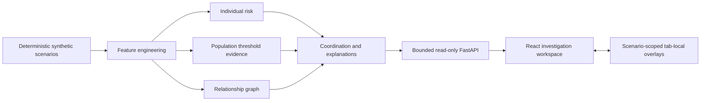
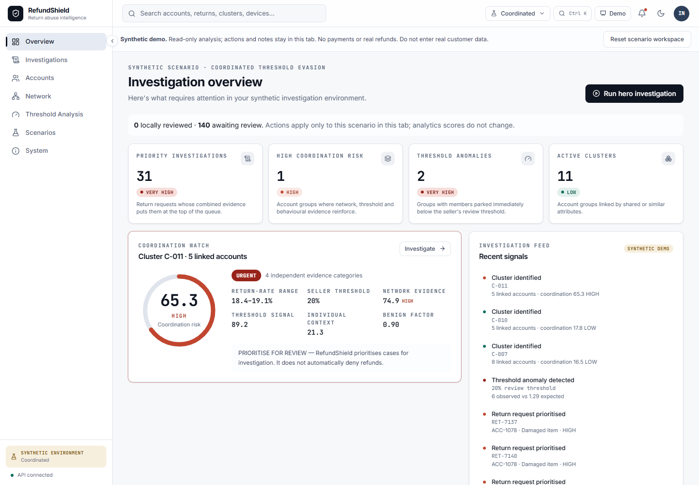
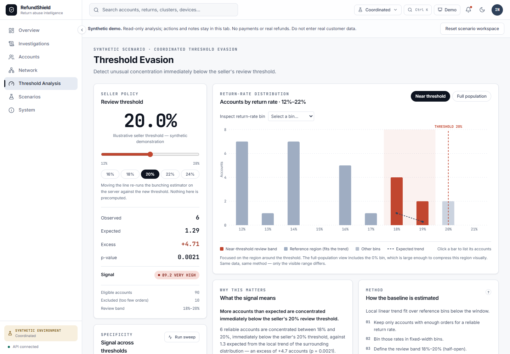
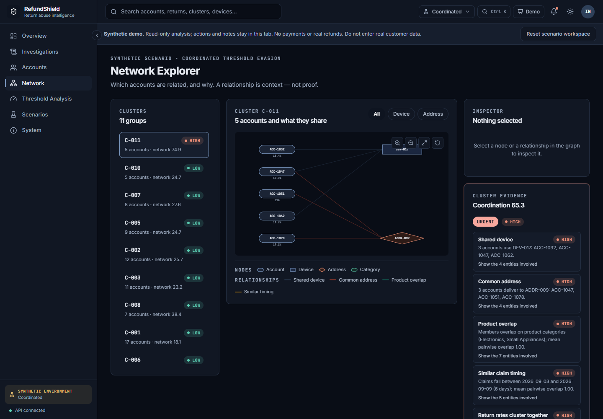

# RefundShield

**Explainable investigation of coordinated synthetic return abuse.**

Built by **The Anomaly Syndicate** for **CX0507 — The Fraudulent Refund Loop**, FinTech & Digital Economy. Published with team-leader authorization and team attribution. Original project code is licensed under MIT; third-party licenses and notices remain unchanged. See LICENSE and NOTICE.md.

## The problem

A seller may review accounts whose return rate exceeds a policy threshold. Coordinated accounts can distribute activity so each remains below that line. RefundShield demonstrates how an investigator can compare individual behavior, population patterns and relationships without treating one signal as proof.

Every account, order and return is generated synthetic data. Scores are transparent rules and investigation priorities, **not validated fraud probabilities**. No real customer ingestion, trained model, payment integration or actual refund execution is implemented.

## What you can do

- Review overview metrics and filter, sort and inspect investigations and accounts.
- Compare individual risk, threshold-bunching evidence, relationship graphs and coordination explanations.
- Inspect graph nodes/edges with keyboard controls, relationship filters and account drill-down.
- Explore thresholds, inspect distribution bins, run a bounded threshold sweep and compare scenarios.
- Search synthetic records, follow deep links and use the guided investigation demonstration.
- Simulate review/escalation/request/approval, write synthetic notes and export JSON/CSV summaries.
- Reload a tab to restore its local workspace, switch isolated scenarios and confirm a per-scenario reset.

Actions and notes remain in bounded, versioned **tab sessionStorage**. They are never sent to a shared mutable case API and do not change analytical scores. Local history and exports are editable simulation records, not legally authoritative audit evidence. Never enter real customer information.

## Architecture



Stack: React 18, TypeScript, Vite 6, React Router 7, Tailwind CSS 3, Recharts 2, Framer Motion and Lucide; Python 3.14, FastAPI, Uvicorn, NumPy, pandas and NetworkX. No database or external API is required for this synthetic scope. Inter/JetBrains Mono fonts are bundled locally with their OFL notices.

## Synthetic screenshots

These selected local captures show synthetic examples only; they are not evidence of a deployed service or real fraud detection performance.





## Local development

Tested tool versions and actual results are in [validation](docs/VALIDATION.md). Use Python 3.14.10 and Node 22.23.4/npm 10.9.9 for the documented setup. The Linux wheel locks target CPython 3.14 / amd64 / musllinux on the pinned Alpine image; they are not universal OS locks.

From the repository root:

```powershell
python -m venv .venv
.\.venv\Scripts\python -m pip install --only-binary=:all: -r backend/requirements-dev.txt
.\.venv\Scripts\python -m pip check
cd backend
..\.venv\Scripts\python -m uvicorn app.main:app --host 127.0.0.1 --port 8000 --no-access-log
```

In another terminal:

```powershell
cd frontend
npm ci --ignore-scripts --no-audit --no-fund
npm run dev -- --host 127.0.0.1 --port 5173 --strictPort
```

Open `http://127.0.0.1:5173`. Vite proxies `/api` to the local backend. No credentials or env file are required. The optional `frontend/.env.example` contains only a public build-time API base placeholder. VITE variables are visible in the browser and must contain no secrets. Ordinary setup uses the committed lock, not `npm install` or a forced audit fix.

For exact target dependencies, use the hash-verified container build described in [deployment](docs/DEPLOYMENT.md). Development dependencies on other operating systems require their own tested resolution; the preserved tested constraints bound versions but do not pin every possible OS wheel hash.

## Try an investigation

1. Select Coordinated Threshold Evasion and compare its three evidence streams.
2. Open investigations, filter `RET-7137`, inspect its account/network and enter a short synthetic note.
3. Simulate escalation, reload and confirm the detail, queue and overview agree on local status.
4. Switch to the household scenario as a benign control; its local state is independent.
5. Reset the selected scenario and confirm its notes/history clear without changing scores or another scenario.
6. Explore thresholds, compare scenarios and download the existing synthetic JSON/CSV exports.

## Verification

Executed private release-candidate checks: **156 backend tests, 53 frontend tests, typecheck and production builds passed**. Chrome, Edge, Firefox and Playwright WebKit each passed49 workflows and16 automated accessibility audits. The exact versions, limits and corrected failures are recorded below and in [validation](docs/VALIDATION.md); these results do not certify manual accessibility or a public host.

```powershell
cd backend
..\.venv\Scripts\python -m pytest tests -q
cd ../frontend
npm test
npm run typecheck
npm run build
```

Linux backend/security tests can run in the separate `deploy/Dockerfile.test` image without adding pytest or browser tools to production. Browser QA lives under `qa/`; its configurable Chromium/Edge/Firefox/WebKit checks target approved loopback endpoints only. [Validation](docs/VALIDATION.md) records executed results, initial failures and remaining manual checks. [Security](docs/DEPENDENCY_SECURITY.md) distinguishes package advisories from base-image findings and license obligations.

## Limits and release status

A separate [Render Free adapter](docs/RENDER_DEPLOYMENT.md) prepares one non-root Docker web service with static assets, same-origin `/api` and a private Unix-socket backend. It preserves the original deployment and analytics. The adapter requires its own release review and separately authorized hosting; this repository does not establish a live website. Local target setup, test commands and Free-tier limitations are documented there.

- Synthetic rules demonstrate a mechanism; no real-world accuracy, precision, recall or fraud-probability claims are made. Shared infrastructure can be legitimate.
- Local notes are limited to 2,000 characters, 100 retained cases and 60 actions per case. Corrupt/unavailable storage recovers with a notice. Tab duplication/session restoration may preserve an initial snapshot; this is not secure deletion or a guaranteed retention deadline.
- The API is read-only and bounded, with a finite analysis cache and process-wide capacity controls. Public hosting also needs reviewed edge budgets, monitoring and operational ownership.
- Recharts 2 and the test-only jsdom encoding dependency have maintenance warnings. Migration is separate work with regression coverage.
- Manual screen-reader, touch, zoom, forced-color and physical-device checks are not established by automated Axe or viewport tests. See the recorded browser coverage.

**Live demo:** not deployed; no URL exists. A team-approved HTTPS location will be added after separate hosting authorization and the release gates pass. Original project code is MIT-licensed; bundled third-party material retains its own terms. Review [NOTICE](NOTICE.md), [CONTRIBUTORS](CONTRIBUTORS.md), [architecture](docs/DEVELOPMENT.md), [deployment and rollback](docs/DEPLOYMENT.md) and [release checklist](docs/RELEASE_READINESS.md).
